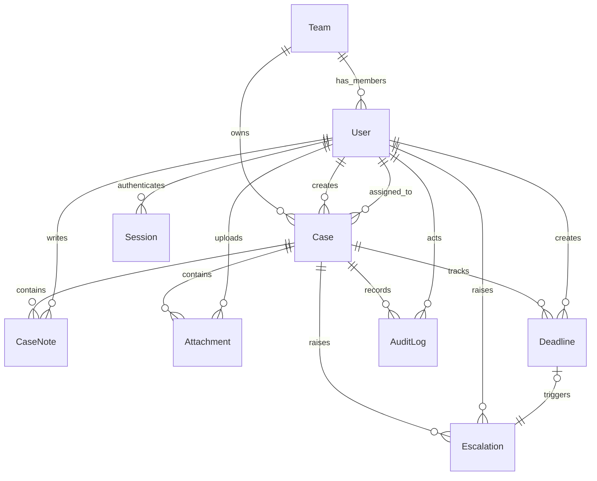

# Domain Model

Entities and ownership:

- `Team`
  Schema/model: `prisma/schema.prisma` — `model Team`
  Primary service: `src/services/referenceDataService.ts` — `getTeamOptions()`
- `User`
  Schema/model: `prisma/schema.prisma` — `model User`
  Primary service: `src/services/authService.ts` — `loginUser()`
- `Session`
  Schema/model: `prisma/schema.prisma` — `model Session`
  Primary service: `src/services/authService.ts` — `loginUser()`
- `Case`
  Schema/model: `prisma/schema.prisma` — `model Case`
  Primary service: `src/services/caseService.ts` — `createCase()`, `updateCase()`, `transitionCase()`, `listVisibleCases()`
- `CaseNote`
  Schema/model: `prisma/schema.prisma` — `model CaseNote`
  Primary service: `src/services/caseService.ts` — `addCaseNote()`
- `Attachment`
  Schema/model: `prisma/schema.prisma` — `model Attachment`
  Primary service: `src/services/caseService.ts` — `addCaseAttachment()`
- `Deadline`
  Schema/model: `prisma/schema.prisma` — `model Deadline`
  Primary service: `src/services/caseService.ts` — `addCaseDeadline()`
- `Escalation`
  Schema/model: `prisma/schema.prisma` — `model Escalation`
  Primary service: `src/services/escalationService.ts` — `runEscalationSweep()`
- `AuditLog`
  Schema/model: `prisma/schema.prisma` — `model AuditLog`
  Primary service: `src/services/caseService.ts` and `src/services/escalationService.ts` via `createAuditLog()`

Relationship notes:

- Team ownership is attached to the `Case.owningTeamId` column in `prisma/schema.prisma`, and team visibility is enforced centrally in `src/lib/auth/authorize.ts` through `buildCaseAccessWhere()`.
- Restricted notes are still children of `Case`, but visibility is filtered later in `src/services/caseService.ts` inside `serializeCaseDetail()`.
- `Escalation.triggeredByDeadlineId` (`prisma/schema.prisma:179`, `String? @unique`) models at most one auto-created escalation per deadline. Duplicate avoidance during repeated sweeps actually comes from two layers: the query filter `escalation: { is: null }` plus `status: "OPEN"` in `findOverdueDeadlinesWithoutEscalation()` (`src/repositories/caseRepository.ts:285-306`) skips already-handled deadlines, and the `@unique` constraint is the backstop that turns a concurrent duplicate into a database error instead of a second row. (The original wording, "`Deadline.triggeredByDeadlineId` on `Escalation`", named the column on the wrong model.)

## Field-level notes that matter for behavior

All line numbers refer to `prisma/schema.prisma`.

- `User.teamId` is optional (`:66`). For team-scoped roles a missing team is handled defensively: `buildCaseAccessWhere()` throws rather than widening to `{}` (`src/lib/auth/authorize.ts:49-52`). Seeded `ADMIN` and `OPERATIONS_MANAGER` users still get a team (`prisma/seed.ts:35`, `:46`), though nothing requires it.
- `User` has no `isActive`/`disabledAt` column. There is no way to deactivate a user other than deleting the row; `assertAssignableUser()` (`src/services/caseService.ts:76-91`) checks only existence and team.
- `Case.caseNumber` is `@unique` (`:96`) and generated as `CAS-<UTC year>-<first 8 hex chars of a UUID, uppercased>` (`src/services/caseService.ts:149`). Eight hex characters give 2^32 values per year; a collision would surface as a Prisma unique-constraint error and a `500`, not a retry.
- `Case.severity` is a bare `Int` (`:101`). The 1–5 range is enforced only by Zod (`src/lib/validation/caseSchemas.ts:20`), not by the database.
- `Case.closedAt` (`:108`) is set by `transitionCase()` to `new Date()` on `CLOSED` and to `null` on every other transition (`src/services/caseService.ts:427`). The escalation sweep's status write (`src/services/escalationService.ts:45-47`) does not touch `closedAt`.
- `Case` indexes `[owningTeamId, status]` and `[assignedToId, status]` (`:122-123`) match the team-scoped list filters. There is no index on `updatedAt`, which is the list sort key (`src/repositories/caseRepository.ts:176-178`).
- `AuditLog.caseId` and `actorId` are nullable with `onDelete: SetNull` (`:196-197`, `:204-205`), so audit history survives a case or user deletion. `CaseNote`, `Attachment`, `Deadline` and `Escalation` cascade on case delete (`:134`, `:150`, `:166`, `:186`). No route deletes cases, so these rules are latent.
- `AuditLog.metadata` is untyped `Json` (`:201`). What goes into it is decided at each call site; see the restricted-comment leak in `docs/architecture/auth-and-permissions.md` (Finding A2).
- `Attachment.storageKey` (`:145`) is free text supplied by the client and validated only for length (`src/lib/validation/caseSchemas.ts:40`). No upload or storage integration exists; the UI always sends the fixed key `cases/demo/sample-evidence.pdf` (`src/components/cases/CaseDetailView.tsx:37-42`).

## Enum lifecycles: which values the code can actually reach

| Enum | Values in schema | Values any code path writes | Unreachable |
|---|---|---|---|
| `CaseStatus` (`:18-27`) | 8 | all 8 via `transitionCase()`; `ESCALATED` also via the sweep | none |
| `DeadlineStatus` (`:36-41`) | `OPEN`, `MET`, `MISSED`, `WAIVED` | `OPEN` (default), `MISSED` (`escalationService.ts:39-42`) | `MET`, `WAIVED` |
| `EscalationStatus` (`:43-47`) | `OPEN`, `ACKNOWLEDGED`, `RESOLVED` | `OPEN` (default only) | `ACKNOWLEDGED`, `RESOLVED` |

Verified by searching `src` for every write to `deadline`/`escalation` rows: the only writers are `createDeadlineRecord`, `updateDeadlineRecord` (called once, with `MISSED`), and `createEscalationRecord` (`src/repositories/caseRepository.ts:245-283`). `Escalation.acknowledgedById`, `acknowledgedAt` and `resolvedAt` (`:178`, `:182-183`) are never written.

Consequences that follow directly from the table:

1. **A swept case can never be closed through the API.** `transitionCase()` rejects `CLOSED` while any escalation is not `RESOLVED` (`src/services/caseService.ts:416-422`), and nothing can set an escalation to `RESOLVED`. The case can go `ESCALATED → RESOLVED` but not `RESOLVED → CLOSED`.
2. **Every open deadline on an active case eventually becomes `MISSED`.** There is no "mark met" path, so a deadline that was honored still gets an escalation once `dueAt` passes, unless the case is `CLOSED` or `CANCELLED` first.
3. **Manual escalation creates no `Escalation` row.** Transitioning to `ESCALATED` (`src/services/caseService.ts:412-414`, `:424-450`) writes the status, an audit row and a restricted note. The report's `openEscalations` count (`src/repositories/reportRepository.ts:36-45`) and the close guard therefore ignore manual escalations entirely.

## Check ladder

1. **Goal:** read ownership from the schema. **Check:** name the column that decides which team sees a case and the file that turns it into a filter (`Case.owningTeamId`, `:105`; `src/lib/auth/authorize.ts:55-57`).
2. **Goal:** find unreachable state. **Check:** for each enum above, find the writer; you should end with the same "Unreachable" column.
3. **Goal:** trace a consequence. **Check:** starting from a seeded `IN_PROGRESS` case with an overdue deadline, list the transitions available after a sweep and explain why `CLOSED` is never among them.
4. **Goal:** schema vs validation. **Check:** list two invariants enforced only in Zod and not in the database (`severity` range; `requesterEmail` format, `caseSchemas.ts:22`).
