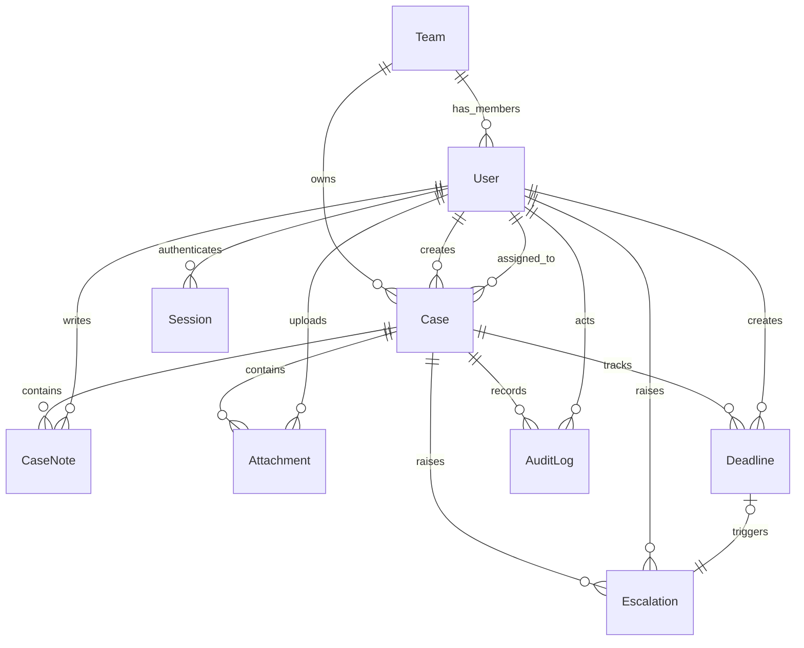

# Domain Model

Entities and ownership:

- `Team`
  Schema/model: `prisma/schema.prisma` — `model Team`
  Primary service: `src/services/referenceDataService.ts` — `getTeamOptions()`
- `User`
  Schema/model: `prisma/schema.prisma` — `model User`
  Primary service: `src/services/authService.ts` — `loginUser()`
- `Session`
  Schema/model: `prisma/schema.prisma` — `model Session`
  Primary service: `src/services/authService.ts` — `loginUser()`
- `Case`
  Schema/model: `prisma/schema.prisma` — `model Case`
  Primary service: `src/services/caseService.ts` — `createCase()`, `updateCase()`, `transitionCase()`, `listVisibleCases()`
- `CaseNote`
  Schema/model: `prisma/schema.prisma` — `model CaseNote`
  Primary service: `src/services/caseService.ts` — `addCaseNote()`
- `Attachment`
  Schema/model: `prisma/schema.prisma` — `model Attachment`
  Primary service: `src/services/caseService.ts` — `addCaseAttachment()`
- `Deadline`
  Schema/model: `prisma/schema.prisma` — `model Deadline`
  Primary service: `src/services/caseService.ts` — `addCaseDeadline()`
- `Escalation`
  Schema/model: `prisma/schema.prisma` — `model Escalation`
  Primary service: `src/services/escalationService.ts` — `runEscalationSweep()`
- `AuditLog`
  Schema/model: `prisma/schema.prisma` — `model AuditLog`
  Primary service: `src/services/caseService.ts` and `src/services/escalationService.ts` via `createAuditLog()`

Relationship notes:

- Team ownership is attached to the `Case.owningTeamId` column in `prisma/schema.prisma`, and team visibility is enforced centrally in `src/lib/auth/authorize.ts` through `buildCaseAccessWhere()`.
- Restricted notes are still children of `Case`, but visibility is filtered later in `src/services/caseService.ts` inside `serializeCaseDetail()`.
- `Deadline.triggeredByDeadlineId` on `Escalation` models one auto-created escalation per missed deadline, which is what lets `src/services/escalationService.ts` avoid duplicating escalations during repeated sweeps.
